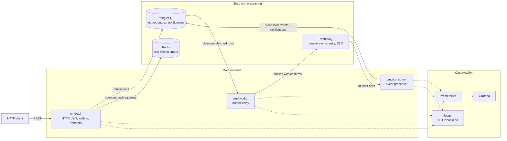
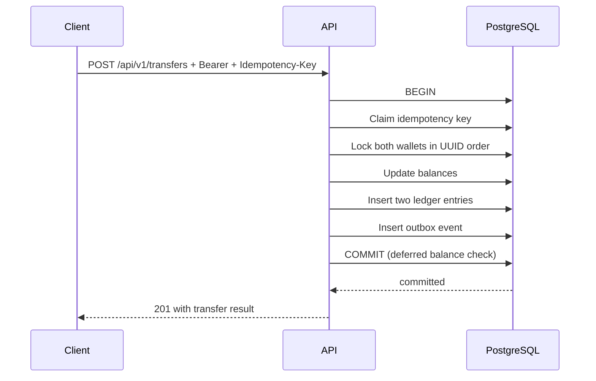

# Mini Payment Processing System

A Go backend for wallet-to-wallet transfers backed by a PostgreSQL double-entry
ledger. **Deposits are simulated** — no bank, card network, or payment provider
is contacted. Every balance in this repository is test data.

The project is a modular monolith with three processes: an HTTP API, an outbox
worker, and a RabbitMQ consumer. PostgreSQL is the financial source of truth;
Redis is used only for rate-limit counters and readiness checks.

## Features

- JWT authentication with argon2id password hashing
- Wallets in USD, EUR, and JPY; simulated, idempotent deposits
- Atomic transfers with deterministic row-level locking
- Append-only double-entry ledger with a deferred balanced-transaction check
- Idempotency keys for deposits and transfers
- Transactional outbox, RabbitMQ publisher confirms, and idempotent consumer
- Prometheus metrics, Grafana dashboards, and OpenTelemetry tracing
- Optional loopback-only pprof listener
- Docker Compose, GitHub Actions CI, k6 load tests, and invariant checks

## Architecture



A transfer is committed in one database transaction:



More diagrams: [architecture and outbox flow](docs/architecture.md),
[database schema](docs/database.md).

### Key decisions

- PostgreSQL is authoritative; no balance or ledger state is cached in Redis.
- Money is `BIGINT` / `int64` in minor units — no floating point.
- Double-entry ledger plus deferred trigger makes an unbalanced commit impossible.
- Wallets are locked in UUID order, so A→B and B→A cannot deadlock.
- Outbox event and money movement commit together; RabbitMQ is never in the
  financial transaction.
- Delivery is at least once; consumers deduplicate by event ID.

Rationale and trade-offs: [architecture decisions](docs/architecture-decisions.md).

### Technology stack

Go 1.26.5, `net/http` ServeMux, pgx v5, go-redis v9, PostgreSQL 17, Redis 7,
RabbitMQ 4, JWT (`golang-jwt/jwt/v5`), argon2id (`golang.org/x/crypto`),
Prometheus client_golang, Grafana 13, OpenTelemetry 1.47, Jaeger 1.76,
Docker Compose 5.5, GitHub Actions, k6 2.4.0.

### Project structure

```text
cmd/api/                     HTTP server
cmd/worker/                  outbox relay
cmd/consumer/                RabbitMQ consumer
cmd/migrate/                 migration CLI
cmd/healthcheck/             static probe for container images
internal/{transport,service,domain}   HTTP, use cases, domain types
internal/repository/postgres/          SQL and transaction logic
internal/{worker,consumer}/            asynchronous processing
internal/{observability,profiling}/    metrics, tracing, audit, pprof
migrations/                  numbered SQL migrations
deployments/                 monitoring and production Compose
tests/load/                  k6 scenarios and invariant checks
docs/                        architecture, schema, API spec, ADRs, performance
```

## Quick start

Prerequisites: Go 1.26.5+, Docker with Compose, Python 3, and `make`. k6 runs
from a pinned container, so no local k6 install is needed.

```sh
cp .env.example .env          # replace placeholder secrets
make config                   # validate Compose files
make up                       # PostgreSQL, Redis, RabbitMQ, Prometheus, Grafana, Jaeger
make migrate-up

go run ./cmd/api              # terminal 1
go run ./cmd/worker           # terminal 2
go run ./cmd/consumer         # terminal 3
```

Useful addresses:

| Service | URL |
| --- | --- |
| API health | http://127.0.0.1:8080/health |
| API readiness | http://127.0.0.1:8080/ready |
| Prometheus | http://127.0.0.1:9090 |
| Grafana | http://127.0.0.1:3000 |
| Jaeger UI | http://127.0.0.1:16686 |

All example configuration is in [.env.example](.env.example). `.env` is ignored
by Git and must contain real local secrets. The HTTP metrics listeners bind to
`0.0.0.0` by default because Prometheus runs in Docker and scrapes host
processes through `host.docker.internal`. For local experiments, keep the stack
on loopback.

## API

All application routes are under `/api/v1`. Requests and responses are JSON.
Protected routes require `Authorization: Bearer <token>`. Deposits and
transfers require a trimmed `Idempotency-Key` header of 1–128 bytes; a replay
returns the original result with `Idempotent-Replay: true`.

| Method | Path | Auth | Purpose |
| --- | --- | --- | --- |
| `POST` | `/api/v1/auth/register` | No | Create user and initial USD wallet |
| `POST` | `/api/v1/auth/login` | No | Issue an access token |
| `GET` | `/api/v1/wallets` | Bearer | List owned wallets |
| `POST` | `/api/v1/wallets` | Bearer | Create a wallet |
| `GET` | `/api/v1/wallets/{id}` | Bearer | Read one wallet |
| `POST` | `/api/v1/wallets/{id}/deposits` | Bearer + key | Simulate a deposit |
| `POST` | `/api/v1/transfers` | Bearer + key | Transfer between owned wallets |
| `GET` | `/api/v1/transfers` | Bearer | Transfer history |
| `GET` | `/health`, `/ready`, `/metrics` | No | Probes and metrics |

Example:

```sh
TOKEN=$(curl -s -X POST http://127.0.0.1:8080/api/v1/auth/login \
  -H 'Content-Type: application/json' \
  -d '{"email":"dev@example.com","password":"a-long-test-password"}' \
  | python -c 'import json,sys; print(json.load(sys.stdin)["access_token"])')

curl -s -X POST http://127.0.0.1:8080/api/v1/transfers \
  -H "Authorization: Bearer $TOKEN" \
  -H 'Content-Type: application/json' \
  -H 'Idempotency-Key: transfer-0001' \
  -d '{"source_wallet_id":"…","destination_wallet_id":"…","amount":1000,"currency":"USD"}'
```

The response contains `transfer_id`, `transaction_id`, both wallet IDs,
`amount`, `currency`, `source_balance`, `destination_balance`, and `created_at`.
Errors use `{"error":{"code":"…","message":"…"}}`, for example
`insufficient_funds` (422), `idempotency_conflict` (409), or
`wallet_not_found` (404).

Full request/response schemas and status codes: [OpenAPI spec](docs/openapi.yaml).

## Testing

| Level | Command / location |
| --- | --- |
| Unit and race | `make test`, `make test-race` |
| Integration | `make test-databases`, then set the `TEST_*` variables from CI and run `go test ./...` |
| Concurrency | `TestTransferIntegration` — same-wallet, opposite-direction, replay |
| Load | `tests/load/run.sh <scenario>` — baseline, transfers, idempotency, stress |
| Financial invariants | `tests/load/verify/run-verify.sh` (read-only) |

Load tests require a dedicated stack, raised rate limits, and
`tests/load/.env.k6`; see [tests/load/README.md](tests/load/README.md).
Measured before/after results are in
[docs/performance-report.md](docs/performance-report.md).

## Observability

- Metrics: API `:9091`, worker `:9092`, consumer `:9093`; API also serves `/metrics`.
- Grafana: two provisioned dashboards in the `Mini Payment System` folder.
- Tracing: OpenTelemetry over OTLP to Jaeger; `traceparent` travels through the
  outbox columns and RabbitMQ headers.
- Profiling: opt-in, loopback-only pprof on `127.0.0.1:6060`; never on the
  public listener.

## Security and correctness

- Passwords: argon2id; JWT: HS256 only, short TTL, no email or password in claims.
- Rate limiting: shared Redis counters, 10 auth / 30 financial requests per
  minute per client IP by default; fails closed when Redis is unavailable.
- Trusted proxy headers are ignored unless `TRUSTED_PROXIES` is configured.
- Request bodies are limited to 4 KiB (16 KiB for auth); unknown fields are rejected.
- `.env` is gitignored; `APP_ENV=production` rejects placeholder secrets.
- Ledger entries are append-only; idempotency, row locks, and constraints are
  enforced in PostgreSQL.

## Limitations

- Deposits are simulated; there is no withdrawal, conversion, or settlement.
- No roles, admin API, multi-tenancy, or external notification delivery.
- Transfer history uses bounded offset pagination, not cursor pagination.
- Tokens cannot be revoked before expiry; rate limits are per client IP.
- Services import concrete PostgreSQL repositories, so changing storage would
  require a refactor.
- No CI badge is embedded until the remote and workflow status are verified.
  See [docs/github-presentation.md](docs/github-presentation.md).

## Documentation

- [Architecture diagrams](docs/architecture.md)
- [Database schema](docs/database.md)
- [Architecture decisions](docs/architecture-decisions.md)
- [OpenAPI specification](docs/openapi.yaml)
- [Performance report](docs/performance-report.md)
- [Load testing guide](tests/load/README.md)
- [GitHub presentation](docs/github-presentation.md)

The CI workflow is [.github/workflows/ci.yml](.github/workflows/ci.yml).
