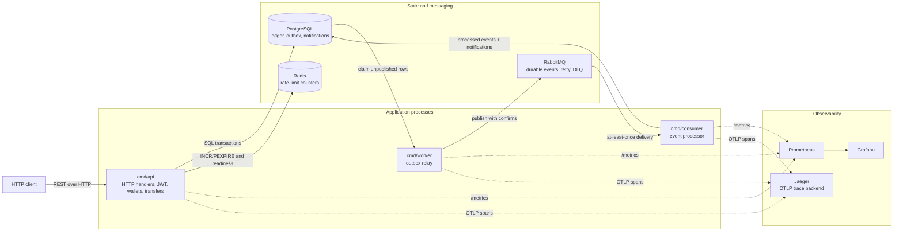
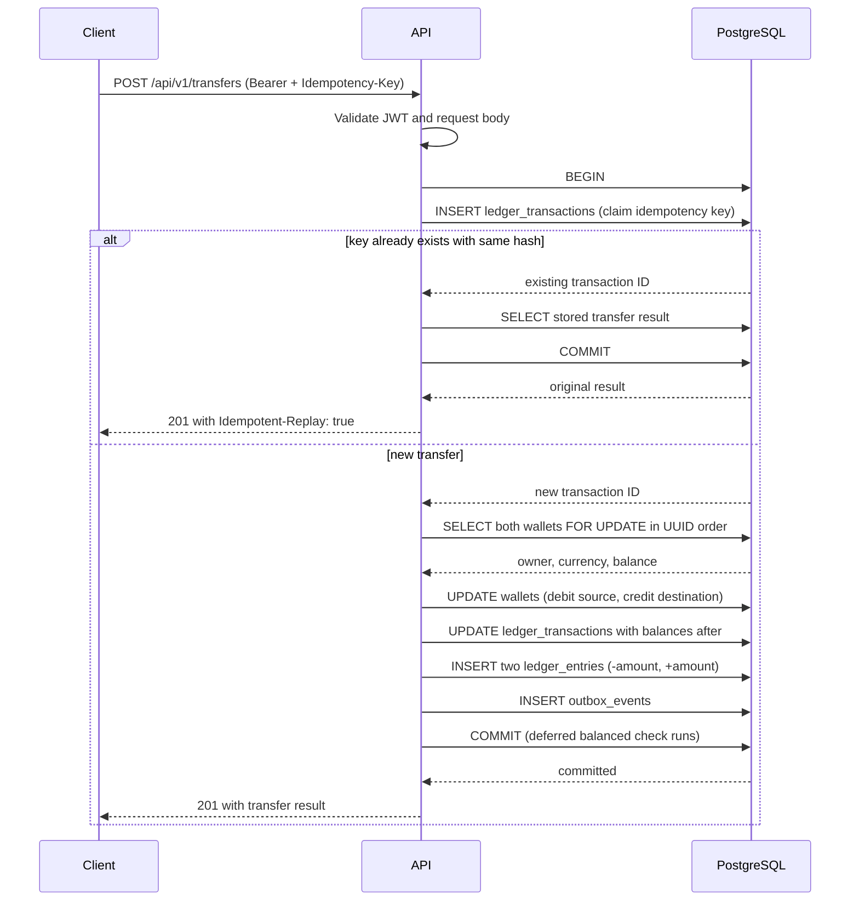
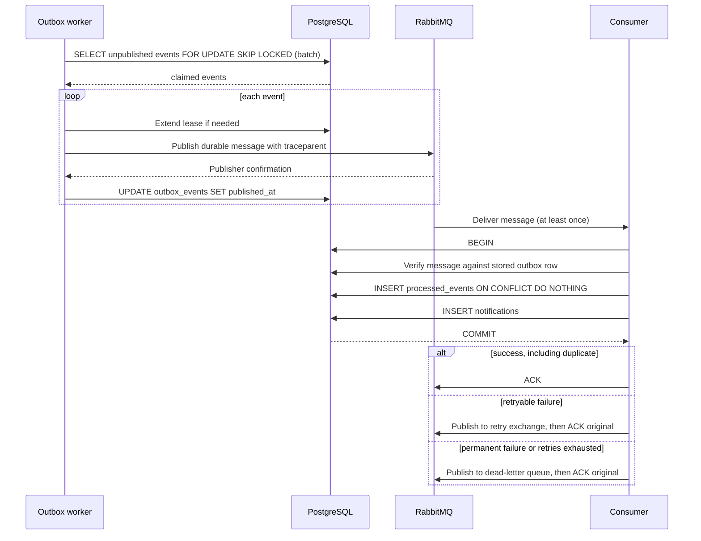

# Architecture diagrams

These diagrams describe the implemented system, not a target design. The
runtime is a modular monolith with three processes: `cmd/api`, `cmd/worker`,
and `cmd/consumer`. All financial state lives in PostgreSQL.

## System architecture

Notes:

- The API also serves `/metrics` on its public listener; each process has a
  separate metrics port for Prometheus scraping.
- pprof is served only when `PROFILING_ENABLED=true` on a separate loopback
  listener; it is never part of the public API handler chain.
- Redis stores no balances, ledger rows, or idempotency records.

## Transfer sequence

Important details:

- Ownership, currency, amount, and balance checks happen after both wallet
  rows are locked, in a deterministic UUID order.
- The outbox row is written inside the same transaction as the money movement.
  A rollback cannot publish a transfer that did not happen.
- The deferred trigger verifies exactly two balanced entries before COMMIT can
  succeed. Idempotency conflicts abort the transaction.

## Outbox and RabbitMQ processing

Important details:

- The worker drains another batch immediately when the previous one was full,
  and otherwise waits for the configured poll interval.
- A message is ACKed only after the notification transaction commits. A
  duplicate delivery commits nothing and is still ACKed.
- Publisher confirms, durable exchanges and queues, at-least-once delivery,
  bounded retry, and a dead-letter queue are part of the implemented topology.
