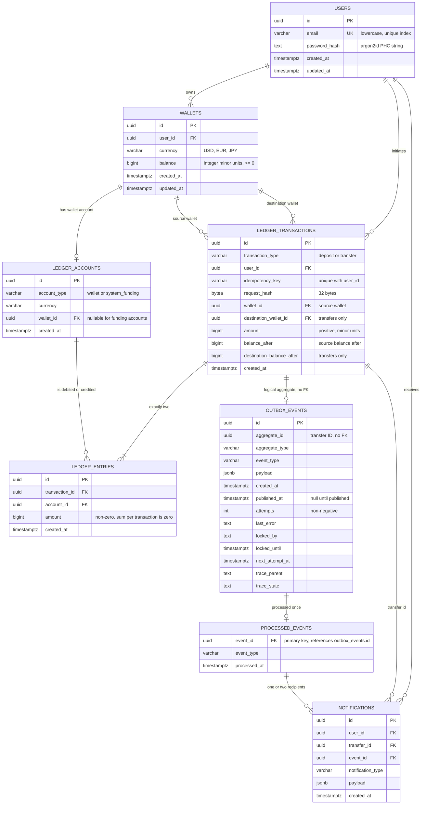

# Database schema

The schema is defined by numbered SQL files in `migrations/`. PostgreSQL is the
only source of truth for financial state.

| Question | Where to look |
| --- | --- |
| How do the tables relate? | [Entity relationships](#entity-relationships) |
| What is each table for? | [Table responsibilities](#table-responsibilities) |
| What prevents invalid money? | [Important constraints](#important-constraints) |
| Why these indexes? | [Important indexes](#important-indexes) |

Two common misconceptions:

- There is **no `transfers` table**. A transfer is a `ledger_transactions` row
  with `transaction_type = 'transfer'`.
- There is **no idempotency table**. `(user_id, idempotency_key)` plus a
  32-byte `request_hash` on `ledger_transactions` serve deposits and transfers.

## Entity relationships

## Table responsibilities

| Table | Purpose |
| --- | --- |
| `users` | Normalised email, argon2id password hash, timestamps |
| `wallets` | Per-user balance in one supported currency |
| `ledger_accounts` | Wallet accounts and one `system_funding` account per currency |
| `ledger_transactions` | Deposit and transfer rows; also the idempotency ledger |
| `ledger_entries` | Append-only double-entry postings |
| `outbox_events` | Events written in the financial transaction, published later |
| `processed_events` | Consumer idempotency marker keyed by outbox event ID |
| `notifications` | Per-user notification rows derived from transfer events |

## Important constraints

- `wallets_balance_nonnegative_check` forbids negative balances; the balance
  column is `BIGINT` in minor units.
- `wallets_user_currency_unique` permits one wallet per currency per user.
- `ledger_transactions_user_key_unique (user_id, idempotency_key)` makes
  retries safe; `request_hash` is exactly 32 bytes and is compared on replay.
- `ledger_transactions_transfer_fields_check` separates deposit and transfer
  shapes and requires distinct source and destination wallets.
- `reject_ledger_entry_mutation` is a trigger that raises on `UPDATE` or
  `DELETE` of `ledger_entries`, making the ledger append-only.
- `ledger_transactions_balanced` and `ledger_entries_transaction_balanced` are
  deferred constraint triggers. At commit they require exactly two entries,
  a zero sum, matching currencies, and type-specific source/destination
  postings.
- `create_wallet_ledger_account` creates the matching ledger account whenever
  a wallet is inserted.
- `processed_events_pkey (event_id)` gives consumer idempotency;
  `notifications_event_user_unique (event_id, user_id)` prevents duplicate
  notifications for one recipient and event.

## Important indexes

| Index | Why it exists |
| --- | --- |
| `users_email_lower_unique_idx` | Case-insensitive unique login lookup |
| `wallets_user_currency_unique` | Wallet lookup and history join from user |
| `ledger_transactions_wallet_created_idx (wallet_id, created_at DESC, id DESC)` | Outgoing history and ordered page |
| `ledger_transactions_destination_wallet_idx (destination_wallet_id, created_at DESC, id DESC) WHERE destination_wallet_id IS NOT NULL` | Incoming history and ordered page |
| `ledger_entries_transaction_idx` | Balanced-check trigger and ledger reads by transaction |
| `ledger_entries_account_created_idx` | Account statement reads |
| `outbox_events_pending_poll_idx (next_attempt_at, created_at, id) WHERE published_at IS NULL` | Matches the worker's claim query and skips published rows |
| `notifications_user_created_idx` | User notification list |
| `notifications_transfer_id_idx` | Notifications for one transfer |

Query plans and measured index decisions are documented in
`performance-report.md`. No index was added in the performance iteration; the
existing composite and partial indexes already matched the measured plans.
